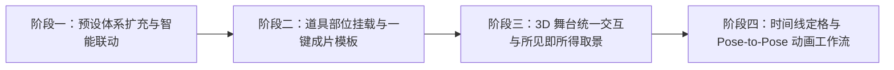

# Pixelstage 海报与小动画制作器升级方案 (`UPGRADE_PLAN.md`)

> [!TIP]
> 本方案已将所有涉及的文件路径、数据结构改动、函数签名与测试验证点精确归档。后续无论是分阶段执行还是在新会话中推进，AI 都无需重新扫描整个代码库，可直接按模块改代码，大幅节省 Token。

---

## 分阶段执行路线图（按模块解耦，支持分步实施）



---

## 阶段一：姿势/动作预设扩充与智能联动

### 1.1 目标与改动点
1. **扩充 20+ 款分类姿势预设**（[lib/poses.ts](file:///home/antigravity/xm1221/voxel-studio/lib/poses.ts)）：
   - 为 `PosePreset` 增加 `category: "daily" | "combat" | "adventure" | "poster"` 与可选 `recommendedClip?: BuiltinClipId`。
   - **日常 (`daily`)**：保留 `idle`（站立）、`wave`（挥手）、`think`（思考）、`salute`（敬礼）、`sit`（坐下）、`walk`（迈步）。
   - **战斗 (`combat`)**：新增 `guard`（持剑格挡）、`slash`（横扫劈砍，推荐动作 `attack`）、`bow`（拉弓瞄准）、`shield`（举盾防御）、`charge`（战神蓄力）、`victory`（高举武器欢呼，推荐动作 `cheer`）。
   - **冒险 (`adventure`)**：新增 `sneak`（潜行观察，推荐动作 `crouch`）、`torch`（举火把探险）、`mine`（挥镐挖矿，推荐动作 `attack`）、`eat`（吃金苹果/喝药水）、`glide`（鞘翅滑翔，推荐动作 `fly`）、`hit`（受击后仰）。
   - **摆拍 (`poster`)**：保留 `hero`（英雄）、`flex`（秀肌肉），新增 `crossed`（双手抱胸）、`chill`（盘腿小憩，推荐动作 `sit`）、`peace`（歪头比耶）、`lookout`（背手远眺）、`lookback`（奔跑回眸）、`duo-back`（背靠背战友）。
2. **左右镜像翻转姿势**（[lib/poses.ts](file:///home/antigravity/xm1221/voxel-studio/lib/poses.ts)）：
   - 新增纯函数 `mirrorJoints(joints: Joints): Joints`：
     - `headY: -joints.headY`
     - `rArmX <-> lArmX`、`rArmZ: -joints.lArmZ`、`lArmZ: -joints.rArmZ`、`rElbow <-> lElbow`
     - `rLegX <-> lLegX`、`rKnee <-> lKnee`
3. **姿势与全身动作智能联动**（[components/studio.tsx](file:///home/antigravity/xm1221/voxel-studio/components/studio.tsx)）：
   - 定义覆盖全身关节的动作集合 `FULL_BODY_CLIPS = new Set(["walk", "run", "crouch", "attack", "fly", "swim", "spin", "jump", "sit"])`。
   - 当用户在「角色 (`cast`)」面板点击静态姿势或拖动关节滑块时，若 `active.clip` 在 `FULL_BODY_CLIPS` 中，自动将 `clip` 切换为 `"idle"`（呼吸），让新姿势立即可见。
   - 若当前选中姿势带有 `recommendedClip`，在姿势区旁提供「一键套用配套动作」快捷按钮。
4. **Schema 与多语言同步**：
   - 更新 [schema/pixelstage.scene.schema.json](file:///home/antigravity/xm1221/voxel-studio/schema/pixelstage.scene.schema.json) 中的 `$defs.poseId.enum`。
   - 更新 [lib/i18n.ts](file:///home/antigravity/xm1221/voxel-studio/lib/i18n.ts) 的 `zh` 与 `en` 词条。

---

## 阶段二：道具部位挂载系统与「一键成片」场景模板

### 2.1 道具挂载到角色骨骼（Equipment / Attachment）
1. **数据结构扩展**（[lib/types.ts](file:///home/antigravity/xm1221/voxel-studio/lib/types.ts)、[lib/props.ts](file:///home/antigravity/xm1221/voxel-studio/lib/props.ts)、[lib/scene-doc.ts](file:///home/antigravity/xm1221/voxel-studio/lib/scene-doc.ts)、[lib/persist.ts](file:///home/antigravity/xm1221/voxel-studio/lib/persist.ts)）：
   - 新增类型：`export type PropAttachSlot = "world" | "rHand" | "lHand" | "head" | "back";`
   - 在 `SceneProp` 上新增可选字段：
     ```ts
     attach?: {
       playerId: string;
       slot: Exclude<PropAttachSlot, "world">;
     } | null;
     ```
   - 默认为 `null`（即世界地面坐标），保持旧版 v1 分享链接与 v2 场景 JSON 100% 向后兼容。
2. **渲染引擎实时骨骼跟随**（[lib/engine.ts](file:///home/antigravity/xm1221/voxel-studio/lib/engine.ts#L499-L538)、[lib/rig/build.ts](file:///home/antigravity/xm1221/voxel-studio/lib/rig/build.ts#L268-L296)）：
   - 在 `Rig` 中挂载点对应关系：
     - `rHand` -> `rig.rElbow`（手部握持点偏移 `(0, -5, 1.5)`，默认握剑倾角）
     - `lHand` -> `rig.lElbow`（手部握持点偏移 `(0, -5, 1.5)`）
     - `head` -> `rig.head`（头顶偏移 `(0, 8.5, 0)`）
     - `back` -> `rig.body`（背部偏移 `(0, 1, -2.5)`）
   - 在 `poseAll()` 与 `syncProps()` 中，若 `prop.attach` 指向存在的 `rig`，将 `propGroup` 的世界矩阵计算为对应骨骼节点的子变换（叠加 `prop.position` / `prop.rotation` / `prop.scale` 作为局部微调量），使角色在呼吸、挥剑、跑步或调滑块时，手中道具实时同步挥舞。
3. **道具面板 UI**（[components/prop-shelf.tsx](file:///home/antigravity/xm1221/voxel-studio/components/prop-shelf.tsx#L233-L279)）：
   - 在选中道具的属性区顶部加入「挂载位置」选择器：`地面 (World)` / `右手 (Right Hand)` / `左手 (Left Hand)` / `头顶 (Head)` / `背部 (Back)`（及目标角色选择），切换至手部时自动赋予合理的握持默认偏移与缩放。

### 2.2 四大「一键成片」经典单人场景模板（Starter Scenes）
1. **新建模板库**（`lib/starter-scenes.ts` 并在 [components/studio.tsx](file:///home/antigravity/xm1221/voxel-studio/components/studio.tsx#L1294-L1308)「场景」面板展示）：
   - 点击模板时**保留当前玩家的皮肤、模型（粗/细臂）、披风与名字**，一键配齐姿势、挂载/地面道具、灯光背景、黄金机位与海报标题：
     1. **荒野英雄 (`wilderness-hero`)**：`hero` / `guard` 姿势 + 右手持 `item:diamond_sword` + 脚边 `block:grass_block` 与 `block:stone` + `noon` 日光 + 低机位仰拍 + `mod-promo` 海报标题。
     2. **矿洞奇遇 (`cave-encounter`)**：`torch` / `sneak` 姿势 + 左手举 `block:torch`、右手持 `item:diamond_pickaxe` + 身后逼近的 `entity:creeper` 与 `block:stone` + `night` / `moon` 冷调轮廓光 + 戏剧性斜角机位。
     3. **下界远征 (`nether-expedition`)**：`slash` 劈砍姿势（配 `attack` 动作）+ 右手持 `item:diamond_sword` + 周围 `block:tnt` 与下界地面 + `nether` 红雾与体积光 (`godrays`) + 动感仰拍机位。
     4. **田园小憩 (`pastoral-rest`)**：`sit` 姿势（配 `sit` 坐姿循环）+ 坐在 `block:oak_log` 上、手持 `item:apple` + 旁边 `entity:pig` 与 `entity:chicken` + `sunset` 黄昏柔光。

---

## 阶段三：3D 舞台统一交互、多人站位朝向与海报取景框

### 3.1 角色朝向（Yaw）与多人站位修复
1. **移除硬编码多人间距**（[lib/engine.ts](file:///home/antigravity/xm1221/voxel-studio/lib/engine.ts#L611)）：
   - 将 `engine.ts:611` 的 `const x = (index - (draft.players.length - 1) / 2) * 22;` 改为 `const x = 0;`，使角色位置完全由 `player.position` 决定，「归位 `(0,0,0)`」真正回到舞台中心。
   - 在「添加角色」时（[components/studio.tsx](file:///home/antigravity/xm1221/voxel-studio/components/studio.tsx#L1391)），为新角色分配不重叠的初始 `position.x`（如 `[-14, 14, -28, 28]`），兼容旧版分享链接时若检测到多人全为 `(0,0,0)` 可按需迁移。
2. **角色独立朝向 `yaw`**（[lib/types.ts](file:///home/antigravity/xm1221/voxel-studio/lib/types.ts)、[lib/rig/build.ts](file:///home/antigravity/xm1221/voxel-studio/lib/rig/build.ts#L463)）：
   - 在 `PlayerDraft` 增加 `yaw?: number`（默认 `0`，范围 `-180` ~ `180` 度），在 `applyJoints` 中将 `rig.root.rotation.y` 设为 `((player.yaw ?? 0) + (extra.yaw ?? 0)) * DEG`。
   - 在「角色 -> 位置」面板增加「朝向 (Yaw)」滑块。

### 3.2 3D 视口直接点选角色/道具 + 共用 3D Gizmo + 全局 Undo/Redo
1. **视口点选角色**（[lib/engine.ts](file:///home/antigravity/xm1221/voxel-studio/lib/engine.ts#L288-L321)）：
   - 在 `buildRig` 中为 `rig.root` 标记 `userData.playerId = rig.id`。
   - `onPointerDown` 射线检测同时检查 `this.gizmo.root`、`this.propRoot` 与 `this.holder`：点击角色即选中该角色并激活 3D Gizmo（移动 `position.x/y/z`、旋转 `yaw`、缩放 `scale`），点击道具即选中该道具并激活 3D Gizmo。移除旧版割裂的 `moveMode` 平面盲拖开关。
2. **全局 Undo/Redo（`Ctrl+Z` / `Ctrl+Y`）**（[components/studio.tsx](file:///home/antigravity/xm1221/voxel-studio/components/studio.tsx#L485-L520)）：
   - 将历史栈从仅存 `props` 扩展为快照 `{ players, activeId, props, activePropId, propClip, poster }`，在任何面板下按 `Ctrl+Z` / `Ctrl+Shift+Z` / `Ctrl+Y` 均可撤销或重做角色姿势、位置、道具与场景改动。

### 3.3 所见即所得的海报取景框（Safe Frame）与实时标题预览
1. **实时取景框与文字叠加层**（[components/studio.tsx](file:///home/antigravity/xm1221/voxel-studio/components/studio.tsx#L1209-L1228)、[app/globals.css](file:///home/antigravity/xm1221/voxel-studio/app/globals.css)）：
   - 在 `.viewport` 内增加一个自适应当前导出比例（`FORMATS` 的 `width / height`）的指针穿透（`pointer-events: none`）2D Canvas / 取景框叠加层。
   - 当用户输入了海报文字（`posterHasText(poster)`）或开启取景框时，直接调用 [lib/poster.ts](file:///home/antigravity/xm1221/voxel-studio/lib/poster.ts) 的 `drawPosterText` 实时绘制在预览框上，并同步 `posterSubjectShift` 偏移，做到 100% 所见即所得。

---

## 阶段四：时间线定格编辑与 Pose-to-Pose 小动画工作流

### 4.1 播放/暂停定格与关键帧快捷工具（[components/timeline-editor.tsx](file:///home/antigravity/xm1221/voxel-studio/components/timeline-editor.tsx)）
1. **播放/暂停状态机**：
   - 新增时间线 `paused` 状态与「播放 / 暂停」「上一帧 / 下一帧」按钮。
   - 点击关键帧或拖动时间尺后**保持在当前时间点定格（`onScrub(time)` 不在 `pointerup` 时强制清空）**，直到用户点击「播放」，让用户可以松开鼠标从容调节 13 个关节滑块（调节时实时写入当前选中的关键帧）。
2. **内置动作一键转关键帧**：
   - 在时间线顶部及空状态区增加「将当前动作展开为关键帧」按钮，调用 `animationForClip(active.clip)`（可采样为精简的 5~9 个关键姿势帧或完整帧），方便在内置「挥剑」「起跳」基础上二次改动作。
3. **Pose-to-Pose 预设直写与关键帧工具**：
   - 在时间线关键帧编辑区提供「套用预设姿势到当前帧」快捷下拉/胶囊条，选中关键帧后点一下「持剑格挡」→ 下一帧点「横扫劈砍」即可生成流畅过渡动画。
   - 增加关键帧「复制当前帧」「左右镜像当前帧 (`mirrorJoints`)」「首尾帧同步（把第 1 帧复制到末尾 `duration`，实现无缝循环）」按钮。
